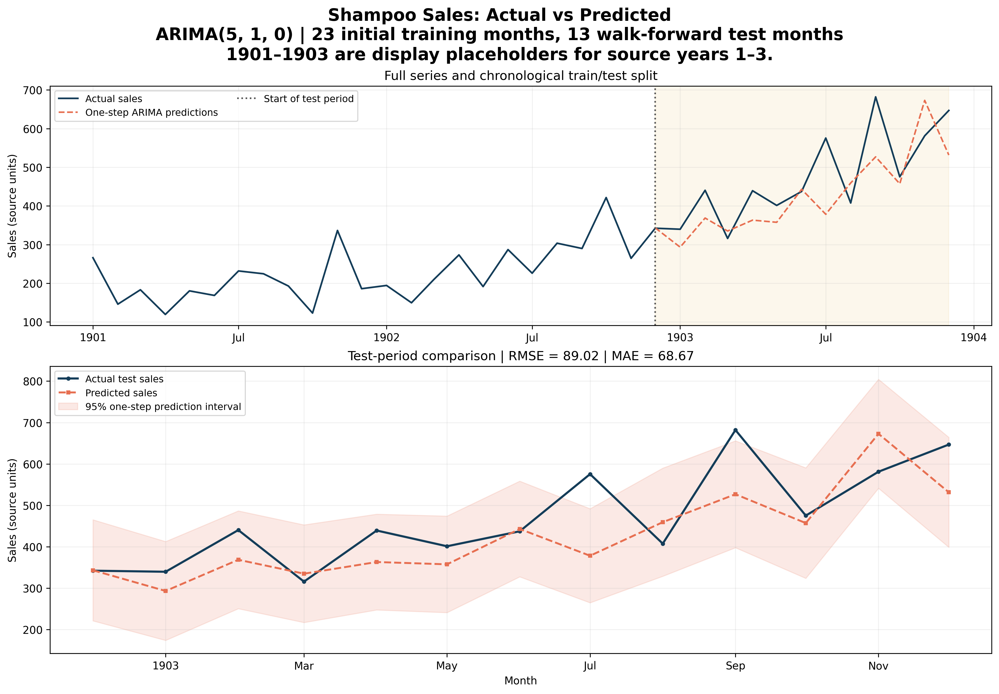
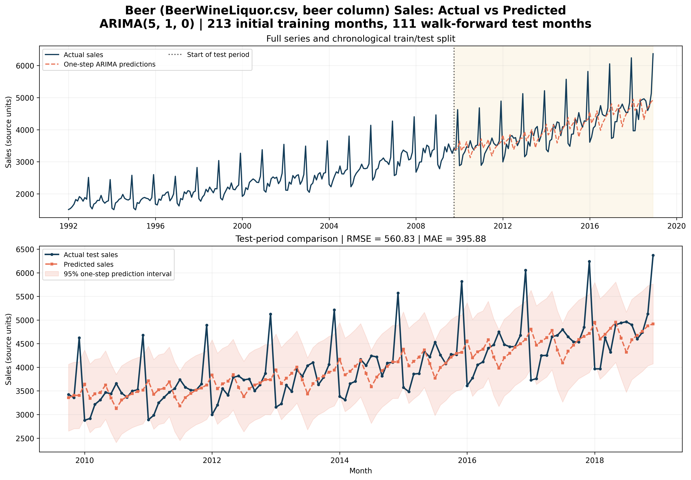

# ARIMA Sales Forecasting — Shampoo and Beer

Joanne Mesadieu

Forecast monthly shampoo and beer sales using the supplied ARIMA notebook and upload plots comparing predictions with actual sales.

## Required plots





## Data

The supplied shampoo.csv contains 36 monthly sales observations. Relative source labels 1-01 through 3-12 are displayed as 1901-01 through 1903-12 to match the supplied notebook. These are plotting placeholders, not independently verified calendar years. BeerWineLiquor.csv contains 324 monthly observations from January 1992 through December 2018 in its beer column. The filename is retained; its contents have not been independently verified as beer-only revenue. Sales units are not stated in the uploads, so figures use source units. Both series are checked for missing values, duplicate dates and missing months; no values are imputed.

## Forecasting method

Both series use statsmodels.tsa.arima.model.ARIMA with order=(5,1,0), preserving the supplied example. p=5 uses five autoregressive lags, d=1 differences the series once, and q=0 has no moving-average term. The first int(0.66 × N) observations form the initial training set: 23 shampoo months and 213 beer months. The remaining 13 and 111 months form the test periods. No random shuffle is used.

For every test month: fit ARIMA on the expanding history, predict exactly the next month, save its 95% prediction interval, then add the newly observed actual sale to history. Test observations become available only after their own prediction is made. This is one-step walk-forward evaluation, not a single forecast of the entire test horizon from the original training cutoff. No parameters are tuned using the test results.

## Results

| Dataset | Model | Train months | Test months | MAE | RMSE | MAPE (%) |
|---|---|---:|---:|---:|---:|---:|
| Shampoo | ARIMA(5,1,0) | 23 | 13 | 68.669 | 89.021 | 13.30 |
| Shampoo | Naive: last month | 23 | 13 | 112.446 | 133.156 | 23.76 |
| Shampoo | Seasonal naive: last year | 23 | 13 | 211.192 | 235.076 | 43.78 |
| Beer | ARIMA(5,1,0) | 213 | 111 | 395.876 | 560.826 | 9.52 |
| Beer | Naive: last month | 213 | 111 | 432.261 | 729.076 | 10.84 |
| Beer | Seasonal naive: last year | 213 | 111 | 158.441 | 184.355 | 3.85 |

Shampoo: ARIMA RMSE is 89.021. The lowest-RMSE method among these three fixed methods is ARIMA(5,1,0) (89.021).

Beer: ARIMA RMSE is 560.826. The lowest-RMSE method among these three fixed methods is Seasonal naive: last year (184.355).

Metrics are calculated automatically from aligned test-date CSVs. MAE is mean absolute error; RMSE is the square root of mean squared error; MAPE is mean absolute percentage error. Lower is better. Naive and seasonal-naive benchmarks forecast the previous month and the same month one year earlier, respectively, using only available history.

## Interpretation and limitations

The beer series has recurring annual peaks, particularly near year end. A nonseasonal ARIMA(5,1,0) need not reproduce these well; a seasonal ARIMA model with period 12 would be a useful follow-up. The task’s fixed ARIMA specification is retained instead of selecting a different model after viewing the test outcomes. Shampoo has only three years of data, making estimation and evaluation sensitive to a few observations. Prediction intervals depend on model assumptions and are not guarantees. Errors are in each dataset’s original scale and should not be directly compared across datasets.

Fits not reporting optimizer convergence: shampoo 0, beer 0. Full warnings are saved in results/fit_warnings.csv.

## Run

Use Python 3.12. From the repository root:
```bash
python -m pip install -r requirements.txt
python src/arima_forecasting.py
```
Or run all cells in ARIMA_Sales_Forecasting.ipynb. The notebook is self-contained: it includes the small supplied CSVs and executable analysis source, creates the project folders if necessary, and writes every figure and CSV. The original teaching notebook is preserved in reference/ARIMA_original.ipynb.

## Submission

Publish this project as a public GitHub repository named Joanne_Mesadieu_ARIMA_Sales_Forecasting. Submit the actual repository URL and upload figures/shampoo_arima_actual_vs_predicted.png and figures/beer_arima_actual_vs_predicted.png to the assignment. A repository link is valid only after it has actually been published; no URL is fabricated in this project.

## Software versions

```json
{
  "python": "3.12.14",
  "numpy": "2.1.3",
  "pandas": "2.2.3",
  "statsmodels": "0.14.4",
  "matplotlib": "3.9.2"
}
```

## References

Inputs: user-provided shampoo.csv, BeerWineLiquor.csv and ARIMA.ipynb. Documentation: https://www.statsmodels.org/stable/generated/statsmodels.tsa.arima.model.ARIMA.html and https://www.statsmodels.org/stable/generated/statsmodels.tsa.arima.model.ARIMAResults.get_forecast.html